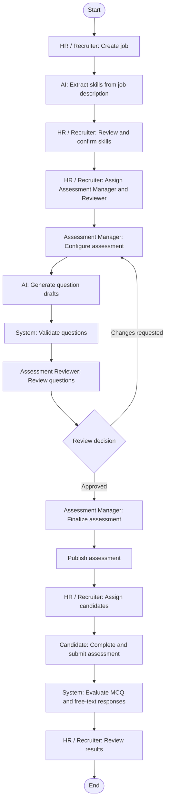
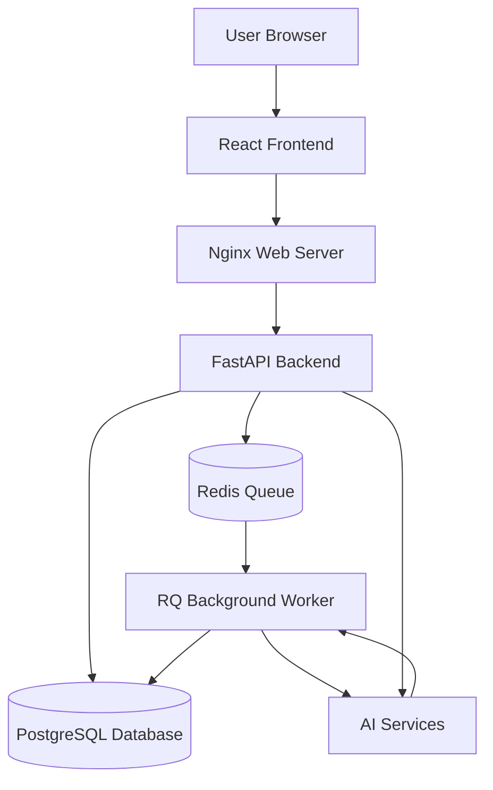

# Evalyn — AI-Powered Recruitment Screening Platform


**Evalyn** is a role-based recruitment screening and assessment platform. It helps teams turn job requirements into structured assessments, manage question quality through human review, deliver assessments to candidates, and evaluate candidate performance.

The platform combines AI-assisted workflows with explicit role ownership and review controls. AI-generated question drafts are validated and reviewed before they are made available for assessment use.

---

## Live Application

The deployed Evalyn application is available at:

**Application URL:** [http://13.127.136.254/](http://13.127.136.254/)

The application is hosted on an AWS EC2 instance. The current deployment uses Docker Compose to run the frontend, backend, and Redis services. PostgreSQL is configured as an external database service.

The public URL currently uses HTTP. HTTPS and a domain name should be configured before using the application for production workloads involving real candidate or organizational data.

---

## Table of Contents

- [Live Application](#live-application)
- [Overview](#overview)
- [Core Capabilities](#core-capabilities)
- [User Roles](#user-roles)
- [End-to-End Workflow](#end-to-end-workflow)
- [System Architecture](#system-architecture)
- [Technology Stack](#technology-stack)
- [Repository Structure](#repository-structure)
- [Getting Started](#getting-started)
- [Background Processing](#background-processing)
- [Environment Variables](#environment-variables)
- [Testing and Quality Checks](#testing-and-quality-checks)
- [Docker Deployment](#docker-deployment)
- [Operational and Security Notes](#operational-and-security-notes)
- [API Documentation](#api-documentation)
- [Troubleshooting](#troubleshooting)
- [Licensing](#licensing)

---

## Overview

Recruitment teams often need to assess different roles against different skills, experience levels, and evaluation criteria. Managing job requirements, assessment content, question quality, candidate attempts, and results across separate tools can make the process difficult to coordinate.

Evalyn provides a shared workflow for these activities:

- Recruiters create jobs and confirm the skills that should be assessed.
- Assessment Managers prepare assessment content for jobs assigned to them.
- Assessment Reviewers independently review questions and assessment readiness.
- Candidates complete assessments assigned to them.
- Organization Administrators manage user access and role assignments.

AI supports selected activities such as skill extraction, question generation, and rubric-based free-text evaluation. Human review remains part of the assessment-quality workflow.

## Core Capabilities

### Job and Requirement Management

- Create and manage job records.
- Work with job descriptions and role requirements.
- Extract skills from job descriptions with AI assistance.
- Review, add, edit, and confirm the skills associated with a job.
- Assign assessment responsibilities to eligible team members.

### Assessment Authoring and Question Management

- Prepare role-specific assessment content based on confirmed job requirements.
- Generate question drafts with configurable generation guidance.
- Organize questions by skill, section, difficulty, and question type.
- Validate generated content and manage question versions.
- Maintain reusable question-bank content.
- Keep question approval and assessment review as explicit workflow steps.

### Review and Approval

- Provide a separate Assessment Reviewer workflow.
- Review assessment content and record approval or rejection decisions.
- Capture review comments and supported checklist information.
- Preserve review history and handoff information.
- Keep assessment preparation separate from independent quality review.

### Candidate Assessment and Evaluation

- Assign eligible candidates to published assessments.
- Support multiple-choice and free-text question types.
- Grade multiple-choice responses deterministically against the saved answer key.
- Evaluate free-text responses with rubric-guided AI assistance.
- Present overall and skill-wise assessment results where supported by the assessment data.

### Role-Based Guidance

- **E-Compass** provides an authenticated, role-aware in-app guide that can answer questions about the current page and the user's workflow.
- The **Handbook** provides role-specific instructions, workflows, navigation guidance, and troubleshooting information.

### Administration and Access

- Authenticate users and protect role-specific application areas.
- Support administrator-managed user roles and invitations.
- Support email-based account activation workflows.
- Protect job and assessment operations according to user roles and assigned access.

## User Roles

### Organization Administrator

- Manage organization users.
- Manage user roles and access.
- Invite users and support account activation.

### HR / Recruiter

- Create and manage jobs.
- Prepare job descriptions.
- Review and confirm extracted skills.
- Assign Assessment Managers and Assessment Reviewers.
- Coordinate assessment readiness.
- Assign candidates to eligible published assessments.
- Monitor candidate progress and results.

### Assessment Manager

- Access assigned jobs.
- Review confirmed job requirements.
- Configure assessment content.
- Generate and manage assessment questions.
- Resolve question validation issues.
- Prepare assessments for independent review.
- Respond to review feedback.

### Assessment Reviewer

- Access assigned review work.
- Independently review assessment questions.
- Check question quality and relevance.
- Approve or reject supported review items.
- Record review feedback.
- Participate in the assessment review and handoff workflow.

### Candidate

- Access assigned assessments.
- Read assessment instructions.
- Start assessment attempts.
- Answer MCQ and free-text questions.
- Submit assessment responses.
- Access available assessment status and results.

Access to protected pages and API operations is controlled by the authenticated user's role. Job-specific actions may also depend on assignment and ownership.

## End-to-End Workflow

The main recruitment-to-assessment workflow is:

1. **Create a job** — HR / Recruiter creates the vacancy and enters its requirements.
2. **Review job skills** — Evalyn assists with skill extraction; HR checks and confirms the skills.
3. **Assign the assessment team** — HR assigns an Assessment Manager and an independent Assessment Reviewer.
4. **Prepare the assessment** — The Assessment Manager configures assessment content and generates or selects questions.
5. **Validate and review** — Question validation and independent human review take place before assessment publication.
6. **Publish the assessment** — The assessment follows its supported approval and publication workflow.
7. **Assign candidates** — Eligible candidates are assigned to the published assessment.
8. **Complete and evaluate** — Candidates submit their attempts; responses are evaluated and results are made available through the supported workflow.

### Application Workflow

The following flowchart shows how the different roles interact throughout the recruitment and assessment process.



## System Architecture

Evalyn is organized as a React frontend, a FastAPI backend, a PostgreSQL database, and Redis-backed background processing.

### Architecture Flowchart



### Request and Processing Model

- The React application communicates with the FastAPI backend through the configured API base URL.
- In the Docker Compose deployment, Nginx serves the built frontend and proxies `/api/` requests to the backend service.
- FastAPI handles authentication, authorization, business workflows, and database access.
- Long-running assessment-generation work is queued through Redis and processed by an RQ worker.
- The Docker backend entry point starts the API process and the `assessment-generation` worker in the backend container.
- PostgreSQL stores application, assessment, question, and workflow data.

The Docker Compose configuration uses an external PostgreSQL connection, for example a managed PostgreSQL service. PostgreSQL is not provisioned as a service in the repository's Compose file.

## Technology Stack

### Frontend

- React 19
- JavaScript
- Vite
- React Router
- Tailwind CSS
- Axios
- Lucide React

### Backend

- Python 3.12
- FastAPI
- Pydantic
- SQLAlchemy
- JWT-based authentication
- Role-based access control

### Database

- PostgreSQL
- Supabase PostgreSQL
- SQLAlchemy ORM
- Alembic database migrations

### AI / GenAI

- Google Gemini
- Groq
- LLM-assisted job skill extraction
- AI-assisted assessment question generation
- Question generation planning and validation
- Rubric-based free-text evaluation

### Background Processing

- Redis
- Redis Queue (RQ)
- Background assessment-generation workers
- Job status and progress tracking

### Retrieval and Machine Learning

- FAISS CPU
- Sentence Transformers
- Embedding-based semantic retrieval dependencies

### Deployment and Infrastructure

- Docker
- Docker Compose
- Nginx
- AWS EC2
- Supabase PostgreSQL

## Repository Structure

```text
Fullstack-Based-AI-Screening-Platform/
│
├── backend/
│   ├── alembic/
│   │   └── versions/
│   ├── app/
│   │   ├── api/
│   │   │   └── routes/
│   │   ├── core/
│   │   ├── db/
│   │   ├── models/
│   │   ├── queue/
│   │   ├── schemas/
│   │   ├── services/
│   │   └── workers/
│   ├── tests/
│   ├── Dockerfile
│   ├── docker_entrypoint.py
│   ├── alembic.ini
│   ├── requirements.txt
│   └── requirements-queue.txt
│
├── frontend/
│   ├── public/
│   ├── src/
│   │   ├── components/
│   │   ├── context/
│   │   ├── layouts/
│   │   ├── pages/
│   │   └── services/
│   ├── Dockerfile
│   ├── nginx.conf
│   ├── package.json
│   └── package-lock.json
│
├── licenses/
├── scripts/
├── .env.production.example
├── compose.yml
└── README.md
```

## Getting Started

The following instructions describe a local development setup. Use a separate production environment configuration for Docker deployment.

### Prerequisites

Install the following tools before setting up the application:

- Python 3.12
- Node.js 22 or later
- npm
- PostgreSQL
- Redis 7 or compatible
- Git
- Docker (for containerized deployment)

A PostgreSQL database and Redis instance must be reachable before starting the backend workflows that depend on them.

### 1. Clone the Repository

```bash
git clone https://github.com/Smriti12182004/Fullstack-Based-AI-Screening-Platform.git

cd Fullstack-Based-AI-Screening-Platform
```

### 2. Create the Python Virtual Environment

For Windows PowerShell:

```powershell
py -3.12 -m venv .venv

.\.venv\Scripts\Activate.ps1
```

If PowerShell blocks activation in the current terminal:

```powershell
Set-ExecutionPolicy -Scope Process -ExecutionPolicy RemoteSigned

.\.venv\Scripts\Activate.ps1
```

For Linux or macOS:

```bash
python3.12 -m venv .venv

source .venv/bin/activate
```

### 3. Install Backend Dependencies

From the repository root:

```bash
python -m pip install --upgrade pip

python -m pip install -r backend/requirements.txt

python -m pip install -r backend/requirements-queue.txt
```

### 4. Configure Backend Environment Variables

The backend reads its local configuration from:

```text
backend/.env
```

Create this file manually and configure the required database, application-secret, LLM, and SMTP settings.

The required environment variables are described in the Environment Variables section below.

Do not commit the local `.env` file or any real credentials to GitHub.

### 5. Install Frontend Dependencies

```bash
cd frontend

npm ci
```

### 6. Configure the Database

Make sure PostgreSQL is running and `DATABASE_URL` is correctly configured in `backend/.env`.

From the backend directory:

```bash
python -m alembic upgrade head
```

### 7. Start Redis

If Redis is not already installed locally, you can start a development instance using Docker:

```bash
docker run --name evalyn-redis -p 6379:6379 -d redis:7-alpine
```

The example local Redis URL is:

```text
redis://127.0.0.1:6379/0
```

### 8. Start the Backend API

From the backend directory:

```bash
python -m uvicorn app.main:app --reload --host 127.0.0.1 --port 8000
```

The backend will be available at:

```text
http://127.0.0.1:8000
```

### 9. Start the Background Worker

Open another terminal, activate the same Python virtual environment, and run:

```bash
cd backend

rq worker -u "redis://127.0.0.1:6379/0" assessment-generation
```

The worker must use the same Redis instance and queue name as the backend.

### 10. Start the Frontend

Open another terminal:

```bash
cd frontend

npm run dev
```

The Vite development server normally runs at:

```text
http://localhost:5173
```

The frontend API client defaults to `http://127.0.0.1:8000`. To use a different backend URL, set `VITE_API_BASE_URL` before starting Vite.

## Background Processing

Evalyn uses Redis and RQ for long-running assessment-generation jobs.

The processing flow is:

1. The frontend submits an assessment-generation request to FastAPI.
2. FastAPI validates the request and enqueues the job in Redis.
3. The RQ worker consumes the job from the `assessment-generation` queue.
4. The worker calls the assessment-generation service and its configured AI integration.
5. Validated results and generation state are persisted through the backend data layer.
6. The frontend can retrieve job status through the application's assessment-generation workflow.

For local development, keep Redis and the RQ worker running while testing background assessment generation.

## Environment Variables

Never commit real credentials. The names below describe the configuration used by the application and the root Docker deployment template.

### Application Configuration

- `APP_NAME` — Application/API display name.
- `APP_VERSION` — Application version.
- `DEBUG` — Debug mode. Use `false` in deployment.

### Database and Security

- `DATABASE_URL` — PostgreSQL connection URL.
- `SECRET_KEY` — Long, randomly generated application secret.

### AI Configuration

- `LLM_PROVIDER` — Provider selection for supported LLM operations (`gemini` or `groq`).
- `GEMINI_API_KEY` — Gemini API key.
- `GEMINI_MODEL` — Gemini model name.
- `GROQ_API_KEY` — Groq API key.
- `GROQ_MODEL` — Groq model name.

### Email Configuration

- `SMTP_HOST` — SMTP server hostname.
- `SMTP_PORT` — SMTP server port.
- `SMTP_USERNAME` — SMTP authentication username.
- `SMTP_PASSWORD` — SMTP authentication password.
- `SMTP_FROM_EMAIL` — Verified sender email address.
- `SMTP_FROM_NAME` — Sender display name.

### Application URLs

- `BACKEND_BASE_URL` — Public backend URL used in application links.
- `FRONTEND_BASE_URL` — Public frontend URL used in application links.

### Background Processing

- `EVALYN_REDIS_URL` — Redis URL used by the assessment queue.
- `REDIS_URL` — Redis connection URL used by queue-related components.

### Frontend Configuration

- `VITE_API_BASE_URL` — Frontend API base URL.

The backend's local environment file is `backend/.env`.

The Docker Compose deployment uses `.env.production` in the repository root. A tracked template is provided in `.env.production.example`.

Copy the template before deployment:

```bash
cp .env.production.example .env.production
```

Replace every placeholder with the correct configuration for the target environment.

Never upload real API keys, database passwords, SMTP credentials, or application secrets to GitHub.

## Testing and Quality Checks

### Backend Tests

Run the backend test suite from the `backend/` directory with the project virtual environment activated:

```bash
python -m pytest -q
```

Run a focused test file:

```bash
python -m pytest -q tests/test_job_collaboration.py
```

### Frontend Checks

Run the frontend lint command:

```bash
npm run lint
```

Create a production build:

```bash
npm run build
```

The production build output is written to `frontend/dist/`.

## Docker Deployment

The repository includes a Docker Compose deployment for a single-host setup.

The currently deployed application is available at:

**[http://13.127.136.254/](http://13.127.136.254/)**

It runs on AWS EC2 using Docker Compose. The deployment consists of the following services:

### Frontend

- Built using Node.js and Vite.
- Served through Nginx.
- Exposed on port `80`.
- Uses Nginx to forward `/api/` requests to the backend.

### Backend

- Built using the backend Dockerfile.
- Runs the FastAPI application.
- Runs the RQ assessment-generation worker.
- Connects to PostgreSQL and Redis.

### Redis

- Provides the background job queue.
- Uses a persistent Docker volume for Redis data.

PostgreSQL is configured as an external database connection, for example through Supabase PostgreSQL.

### Prepare the Production Environment

From the repository root:

For Windows PowerShell:

```powershell
Copy-Item .env.production.example .env.production
```

For Linux or macOS:

```bash
cp .env.production.example .env.production
```

Edit `.env.production` and replace all placeholder values with the correct configuration.

Use a strong secret key, valid LLM credentials, working SMTP credentials, and the correct public URLs.

Set `DEBUG=false`.

### Build, Migrate, and Start

Build the Docker images:

```bash
docker compose build
```

Apply database migrations:

```bash
docker compose run --rm --no-deps backend python -m alembic upgrade head
```

Start the application:

```bash
docker compose up -d
```

Check service status:

```bash
docker compose ps
```

View application logs:

```bash
docker compose logs -f backend

docker compose logs -f frontend

docker compose logs -f redis
```

The frontend is served on port `80`. Nginx proxies requests under `/api/` to the backend service. The backend and Redis ports are not published directly to the host by the provided Compose configuration.

### Updating a Deployment

After updating the checked-out source code:

```bash
git pull origin main

docker compose build

docker compose run --rm --no-deps backend python -m alembic upgrade head

docker compose up -d

docker compose ps
```

Review backend and frontend logs after deployment. Take a database backup before applying migrations to an existing production database.

## Operational and Security Notes

The Compose configuration is a deployment baseline, not a complete managed production infrastructure.

Before exposing an instance to real users:

- Configure HTTPS through a properly configured reverse proxy or load balancer.
- Restrict inbound network access to the required ports.
- Keep `.env`, `.env.production`, API keys, SMTP credentials, database URLs, and signing secrets out of version control.
- Use a strong, unique `SECRET_KEY` and rotate credentials if they are exposed.
- Use a managed PostgreSQL service or an appropriately maintained PostgreSQL deployment, with tested backups and recovery procedures.
- Monitor backend, worker, frontend, and Redis logs.
- Confirm that database migrations have been applied successfully before routing production traffic.
- Review user roles, access boundaries, email delivery, assessment publication, candidate assignment, and result access.
- Avoid using real candidate personal data in development and test environments.

The current public deployment uses HTTP on port `80`. HTTPS, certificates, production monitoring, and infrastructure-level security controls must be configured separately for the target deployment.

## API Documentation

When the backend is running locally, FastAPI provides interactive API documentation:

- **Swagger UI:** [http://127.0.0.1:8000/docs](http://127.0.0.1:8000/docs)
- **OpenAPI schema:** [http://127.0.0.1:8000/openapi.json](http://127.0.0.1:8000/openapi.json)
- **Health endpoint:** [http://127.0.0.1:8000/health](http://127.0.0.1:8000/health)

In the Docker Compose deployment, Nginx proxies the backend under `/api/`; the corresponding paths are available under `/api/docs`, `/api/openapi.json`, and `/api/health`.

## Troubleshooting

### Backend Cannot Start

- Check that the Python virtual environment is activated.
- Confirm that the backend dependencies are installed.
- Verify that `backend/.env` exists.
- Check the database connection and required environment variables.

### Database Connection Error

- Verify `DATABASE_URL`.
- Confirm that the PostgreSQL database is reachable.
- Check database credentials and network access.
- Confirm that the required migrations have been applied.

### Assessment Generation Remains Queued

- Confirm that Redis is running.
- Confirm that the RQ worker is running.
- Verify that the backend and worker use the same Redis URL.
- Confirm that the worker listens on `assessment-generation`.
- Inspect backend and worker logs.

### Frontend Cannot Reach the Backend

- Check `VITE_API_BASE_URL` in local development.
- Verify that FastAPI is running.
- In Docker deployment, verify the Nginx `/api/` reverse-proxy configuration.
- Check the backend and frontend container logs.

### Email Invitations Are Not Delivered

- Verify SMTP host and port.
- Check SMTP username and password.
- Confirm that the sender email is verified.
- Check the configured frontend and backend public URLs.
- Review the backend email logs.

### Database Changes Are Missing

Run the migration command from the backend directory:

```bash
python -m alembic upgrade head
```

For Docker deployment:

```bash
docker compose run --rm --no-deps backend python -m alembic upgrade head
```

## Licensing

The repository does not currently grant a general open-source license for Evalyn's own source code. Public visibility does not grant permission to reuse, redistribute, or commercially exploit the project code.

- [Licensing overview](licenses/LICENSING.md)
- [Third-party notices](licenses/THIRD_PARTY_NOTICES.txt)
- [Llama 3.2 Community License reference](licenses/llama3.2-community-license.txt)

The utility at `scripts/collect_third_party_license_files.py` collects license evidence from the installed frontend and Python environments. Generated per-package evidence is stored outside the repository by default.

Review the collected evidence and reconcile it with the actual release before distribution. Collection alone is not legal clearance.
